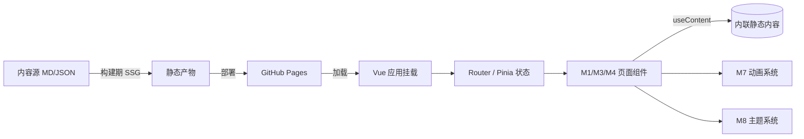

# 个人作品集展示网站（person_show）设计文档

> 版本：v1.1
> 配套：需求文档 v0.4（纯前端、无后端 / 无 SSR，已移除博客板块）
> 核心决策：**Vue 3 + Vite** / 内容用仓库内 Markdown + JSON / 部署 **GitHub Pages 个人主页** / 暗色·亮色**可切换**

---

## 1. 文档目的与范围

本文档在需求文档基础上，进一步说明：

1. 核心模块的内部设计与关键实现点；
2. 构建期 + 运行期的完整数据流转逻辑；
3. 前端动画展示的设计要点与统一动效语言；
4. 典型交互场景的动效规格与实现方式。

全文聚焦前端实现，不涉及任何服务端逻辑。

---

## 2. 技术栈与关键决策

| 维度 | 选型 | 说明 |
|---|---|---|
| 框架 | **Vue 3**（`<script setup>` 组合式 API）+ Vite | 已确认 |
| 路由 | **Vue Router** | 客户端路由，`createWebHistory`，配路由过渡 |
| 状态 | **Pinia** | 仅客户端，轻量（主题偏好等） |
| 内容 | 仓库内 **JSON**（作品 / 简介 / 设计内容） | Git 管理、无后台、易维护 |
| 动画 | **GSAP** + Vue `<Transition>`/`<TransitionGroup>` + `@vueuse/motion` + 原生 CSS | 复杂编排用 GSAP，组件动效用 Vue 内置过渡 |
| 主题 | **CSS 变量（设计令牌）** + `localStorage` | `[data-theme]` 切换，可持久化 |
| 构建 | **SSG（构建期静态生成）** | 禁用 SSR，产物为纯静态文件 |
| 部署 | **GitHub Pages（个人主页）** | Actions 自动构建部署，无运行时服务器 |

---

## 3. 核心模块详细设计

### 3.1 M1 首页 Hero / Landing
- **结构**：全屏 `section`，分三层——背景层（Canvas 粒子 / CSS 渐变流动）、标题层、导航层，底部「向下浏览」引导。
- **关键实现**：Hero 动画用 GSAP 时间线在 `onMounted` 编排；背景动效优先 GPU 合成；导航在 Hero 主体结束后滑入。
- **数据**：精选作品来自 M6 静态产物（构建期内联注入），无运行时请求。

### 3.2 M3 作品展示 Portfolio（作品集核心）
- **按类别分组**：Web 应用 / 组件库 / 数据可视化 / 工具脚本，每类一组卡片网格。
- **代码成品导向**：每个作品展示技术栈标签、源码链接与在线演示链接，强调可验证的实现。
- **数据**：作品来自 `data/portfolio.json`（含类别、缩略图、tech、repo、demo）；展示层通过 `useContent()` 读取。
- **动效**：卡片 hover 微交互 + 滚动渐显（`v-reveal`）；按类别分组自然分隔。

### 3.3 M4 关于我 About（设计向）
- 设计理念陈述、审美风格标签、设计能力进度条（动画填充）、工具链、设计作品网格（占位图）。
- 综合能力进度条作为次要补充；整体突出个人设计能力与审美风格。

### 3.4 M6 内容数据层 Data（构建期静态化）
- **源**：`/data` 下 JSON（简介 / 技能 / 作品 / 设计内容）。
- **构建**：SSG 插件在构建期将 Markdown 渲染为组件/HTML 并注入路由，同时生成索引 JSON。
- **运行时**：组件通过 `import.meta.glob` 或构建期内联直接读取，**无任何网络请求**。
- **解耦**：展示模块只依赖统一内容接口（如 `useContent()`），不直接耦合文件格式。

### 3.5 M7 动画交互系统 Motion
- **统一封装**：`useReveal`（IntersectionObserver 滚动渐显）、`useParallax`（视差）、路由过渡、主题过渡；`prefers-reduced-motion` 全局检测。
- **动效令牌**：`--motion-duration` / `--motion-easing` 集中在 `:root` 或 JS 常量，全站复用。
- **性能**：仅 `transform` / `opacity`；`will-change` 动画期间临时启用、结束移除；统一用 `requestAnimationFrame`。

### 3.6 M8 主题样式系统 Theme
- **设计令牌**：颜色 / 间距 / 字体 / 圆角用 CSS 变量，定义 `[data-theme="dark"]` 与 `[data-theme="light"]` 两套。
- **双主题配色（已定稿）**：品牌双色 **主色 `#fefcff`（近白）** + **辅色 `#b6d4f6`（淡蓝）**，角色分工、适用场景与全部对比度核验见 **`docs/配色标准.md`**（v1.0）。令牌实现落于 `src/styles/theme.css`（CSS 变量）与 `src/theme/tokens.js`（JS 镜像），组件一律引用 `var(--color-*)`。
- **切换**：`ThemeToggle` → 写 `data-theme` 到 `<html>` + `localStorage`；颜色过渡用 CSS `transition` 作用于变量，避免硬切。
- **响应式**：断点 `sm/md/lg/xl`，移动端优先。

---

## 4. 数据流转逻辑（详细）

### 4.1 构建期
```
内容源(Markdown/JSON, 仓库内)
   │  SSG 插件解析 / 渲染 / 注入路由
   ▼
静态产物(HTML/JS/CSS + 内联内容索引)
```

### 4.2 运行期
```
浏览器加载静态产物
   │  Vue 应用挂载
   ▼
Router 解析路由 → 对应页面组件激活
   │  页面通过 useContent() 读取构建期内联/导入的静态内容
   ▼
组件渲染 → 动画系统(M7) 注入进入/滚动动效 → 主题系统(M8) 应用令牌
   │
用户交互(滚动/点击/导航) → 动画系统更新视图(DOM/transform)，无网络、无后端
```

### 4.3 流转图



要点：**读路径**全链路静态、无服务端；**无写路径**（不含留言/表单）；数据流向单向、可预测。

---

## 5. 前端动画展示设计要点

### 5.1 动效体系分层
- **L1 微交互**：按钮/卡片 hover、焦点态（CSS `transition`，<150ms）
- **L2 进入/离开**：路由过渡、列表 stagger（Vue `Transition`/`TransitionGroup`，200–400ms）
- **L3 滚动驱动**：Hero 视差、段落渐显、时间线展开（`IntersectionObserver` + GSAP ScrollTrigger）
- **L4 背景氛围**：粒子/渐变流动（Canvas/WebGL，受性能约束降级）

### 5.2 统一动效语言（令牌）
- **时长档位**：快 160ms / 中 280ms / 慢 420ms
- **缓动**：标准 `cubic-bezier(0.22,1,0.36,1)`（近似 easeOutExpo）；强调 `cubic-bezier(0.34,1.56,0.64,1)`（轻微回弹）
- 全站通过 CSS 变量与 JS 常量统一引用，避免各组件手写不一致。

### 5.3 关键场景动效规格

| 场景 | 技术 | 规格 |
|---|---|---|
| 首屏 Hero | GSAP 时间线 | 背景渐显 600ms → 标题逐字/淡入（每项 80ms stagger）→ 导航滑入 300ms；总控 <1.2s |
| 路由过渡 | Vue `<Transition>` | 淡入 + 位移 8px，280ms easeOutExpo |
| 列表 stagger | `TransitionGroup` + FLIP | 每项延迟 60ms，上移 16px 淡入 |
| 滚动渐显 | `IntersectionObserver` | 进入视口 80% 触发，上移 24px 淡入 420ms |
| 卡片 3D | JS `mousemove` | `rotateX/Y` ±8°，`transform` 跟随光标，离开归位 |
| 主题切换 | CSS 变量 `transition` | 颜色 240ms 过渡，避免硬切 |

### 5.4 性能与降级
- 仅动画 `transform` / `opacity`（GPU 合成层）；避免布局抖动属性（`top/left/width/height`）。
- `will-change` 在动画期间临时添加、结束移除。
- 背景氛围动效在低端设备 / 移动端降级为静态渐变；`prefers-reduced-motion` 下禁用位移/视差，仅保留必要淡入或完全静态。
- 首屏骨架屏 + 内容就绪后平滑替换，避免白屏。

---

## 6. 交互场景详细设计

| 场景 | 触发 | 动效 / 反馈 | 实现要点 |
|---|---|---|---|
| 进入站点 | 首次加载 | Hero 背景流动 → 标题淡入 → 导航滑入 | GSAP 时间线；骨架屏兜底 |
| 查看作品 | 悬停卡片 / 点击 | 卡片微交互 + 阴影加深；首页精选引导至作品集按类别浏览 | 路由 `Transition` + CSS 过渡 |
| 筛选作品 | 点击标签 | 列表项 FLIP 重排动画 | `TransitionGroup` |
| 切换主题 | 点击切换 | 颜色令牌过渡（避免硬切），偏好存 `localStorage` | `[data-theme]` + CSS `transition` |

---

## 7. 项目目录结构（建议）

```
person_show/
├─ data/                   # JSON（简介 / 技能 / 作品 / 设计内容）
├─ src/
│  ├─ main.js
│  ├─ App.vue
│  ├─ router/              # Vue Router（含过渡配置）
│  ├─ stores/              # Pinia（主题等轻量状态）
│  ├─ composables/         # useReveal / useParallax / useContent
│  ├─ motion/              # 动效令牌与统一封装
│  ├─ styles/              # tokens.css / theme.css
│  ├─ layouts/
│  └─ pages/               # M1 / M3 / M4 页面组件
├─ vite.config.js          # SSG + base 路径
└─ .github/workflows/      # GitHub Pages 部署
```

---

## 8. 部署方案（GitHub Pages）

- **构建**：`npm run build`（SSG）生成 `dist/` 静态文件。
- **base 路径**：个人主页（`*.github.io`）用根路径 `base: '/'`；若为仓库页则需 `base: '/<repo>/'`，并在 `createWebHistory(base)` 中一致配置。
- **自动部署**：GitHub Actions（checkout → setup-node → build → deploy to Pages）；或发布到 `gh-pages` 分支。
- **无运行时服务器**：内容已内联 / 预渲染，CDN 直接分发。

---

## 9. 非功能与可访问性

- **性能**：首屏 LCP < 2.5s，动效稳定 60fps，移动端降级。
- **响应式**：适配 320–1920px，移动端优先保证可读与触控。
- **可访问性**：键盘可达、焦点可见、对比度达标、`prefers-reduced-motion` 支持。
- **SEO**：静态预渲染 + 语义化标签 + meta 信息。

---

## 10. 风险与后续

- **内容规模增长**：Markdown 仍由构建期处理，架构无需改动。
- **站内搜索（可选）**：可引入纯客户端索引（如 FlexSearch），不引入后端。
- **内容管理**：维持 Git 即 CMS，不引入后台系统，契合"无后端"约束。
- **视觉风格落地**：暗/亮双主题色板已定稿 —— 见 `docs/配色标准.md`（主色 `#fefcff` + 辅色 `#b6d4f6`，全部对比度达 WCAG AA）。字体方案后续在设计稿阶段确定。
