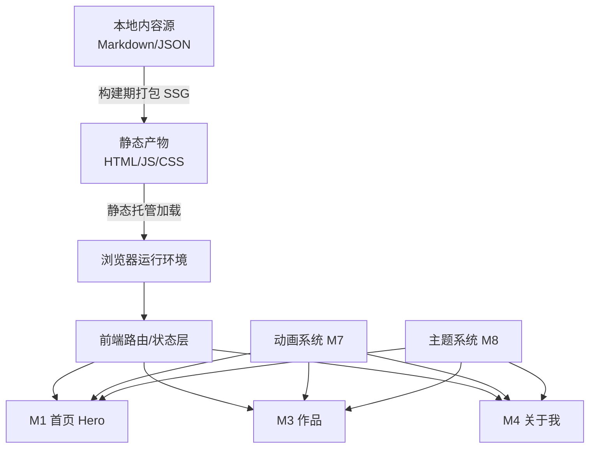

# 个人作品集展示网站（person_show）需求文档

> 版本：v0.4（移除博客板块，聚焦作品集）
> 状态：前端方案定义阶段（已剥离全部后端/SSR 依赖）
> 变更说明：相对 v0.3，本版**移除 M2 博客模块**（列表/详情/分类/标签）；整体结构以**作品集为核心、关于我（设计向）为辅**，同步修订模块划分、依赖关系、数据流、交互场景与后端边界表。

---

## 1. 项目概述

| 项 | 内容 |
|---|---|
| 项目名称 | person_show（个人作品集展示） |
| 产品形态 | 个人作品集 / 设计展示网站 |
| 开发重心 | **纯前端（100%）**，无任何后端 / 服务端渲染依赖 |
| 核心诉求 | 内容展示 + 强视觉体验，界面须包含动画展示效果 |
| 目标产出 | ① 系统架构图（模块结构 + 数据流向）② 设计文档（模块说明 + 数据流转 + 动画设计要点与交互场景） |
| 部署形态 | 静态文件托管（CDN / 对象存储 / 静态站点），**无运行时服务器** |

### 1.1 目标与价值
- 以「第一眼吸引人」为设计基调，用动画与交互传递个人风格，而非单纯罗列信息。
- 保证内容可维护：作品、简介、设计内容以**本地文件**管理，与展示层解耦，便于持续更新（Git 即 CMS）。
- 性能与体验并重：动画不牺牲首屏速度与可访问性；全部逻辑在浏览器内闭环。

---

## 2. 产品定位与目标用户

- **定位**：个人品牌展示窗口（作品集为核心 + 设计向关于我）。
- **目标用户**：潜在雇主 / 同行 / 朋友等访客。
- **使用场景**：PC 与移动端浏览器访问，首次进入重「惊艳感」，后续浏览重「易读性」。
- **关键约束**：页面渲染、数据呈现、用户交互**全部由前端独立完成**，取消对后端的渲染依赖。

---

## 3. 核心功能模块划分

按「展示层 / 数据层 / 支撑层」三层划分，共 6 个模块（**已删除原 M9 后端/第三方模块、M5 互动留言模块与 M2 博客模块**）：

| 编号 | 模块 | 层级 | 一句话职责 |
|---|---|---|---|
| M1 | 首页 Hero / Landing | 展示层 | 首屏品牌动画、导航入口、作品精选引导 |
| M3 | 作品展示 Portfolio | 展示层 | 按类别展示代码成品、详情、源码/演示链接 |
| M4 | 关于我 About | 展示层 | 设计理念、审美风格、设计能力与设计作品 |
| M6 | 内容数据层 Data | 数据层 | 本地 JSON 内容源，构建期打包为静态产物 |
| M7 | 动画交互系统 Motion | 支撑层 | 滚动动画、路由过渡、微交互、动效编排 |
| M8 | 主题样式系统 Theme | 支撑层 | 设计令牌、暗/亮色、响应式、可访问性 |

---

## 4. 模块职责说明

### M1 首页 Hero / Landing
- 首屏全屏动画（背景动效 + 标题进入动画 + 导航渐显）。
- 提供全局导航与「向下浏览」引导。
- 可承载作品精选入口（数据来自 M6 静态产物）。

### M3 作品展示 Portfolio
- 按类别（Web 应用 / 组件库 / 数据可视化 / 工具脚本）分组的作品卡片网格。
- 每个作品突出**代码成品**：技术栈标签、源码与在线演示链接。
- 支持 hover 微交互与滚动渐显。

### M4 关于我 About
- 个人简介、技能雷达/进度条、经历时间线。
- 时间线进入时以滚动动画逐条展开。

### M6 内容数据层 Data（构建期静态化）
- 内容源为**本地仓库内**的 Markdown/MDX 文件与 JSON 数据。
- 构建阶段（SSG）将内容解析、打包进静态产物（HTML/JS），运行时前端直接读取，**无远程拉取、无运行时 API**。
- 通过状态层与展示模块解耦，展示模块不直接耦合内容文件格式。

### M7 动画交互系统 Motion
- 统一动效能力：滚动触发（`IntersectionObserver` / ScrollTrigger）、路由过渡、hover/点击微交互、加载与骨架屏。
- 提供动效编排与性能约束（GPU 加速、`will-change`、60fps、`prefers-reduced-motion` 降级）。

### M8 主题样式系统 Theme
- 设计令牌（颜色、间距、字体、圆角）统一管理。
- 暗色/亮色切换并持久化（存于 `localStorage`，纯前端）。
- 响应式断点 + 可访问性（对比度、焦点可见、键盘可达）。

---

## 5. 后端耦合功能边界界定（须删除项）

明确界定下列「后端 / 服务端」职责**必须从系统中剥离**；前端不保留任何对运行服务端、服务端渲染、后端 API、服务端存储的依赖。原 v0.1 中与之相关的模块（含 M9 后端/第三方、M5 互动留言）一并删除。

| 编号 | 须删除的后端耦合项 | 原归属 | 前端替代方案 |
|---|---|---|---|
| B1 | 服务端渲染 SSR（请求时动态生成 HTML） | 渲染层 | 构建期静态生成（SSG）/ 纯客户端渲染，产物为静态文件 |
| B2 | 运行时后端 API / 数据接口 | 数据层 M6 | 内容在构建期由本地 Markdown/JSON 打包进静态产物，前端直接读取 |
| B3 | 服务端会话 / 鉴权 | — | 无需（无登录、无私密数据） |
| B4 | 服务端数据库 / 内容管理后台 | 数据层 | 内容以代码仓库内文件管理（Git 即 CMS） |
| B5 | 服务端动态路由 / 模板渲染 | 渲染层 | 前端路由（Vue Router / React Router）客户端导航 |

**保留且完全由前端负责的能力：**
- 页面渲染（客户端渲染 / 构建期静态生成，无运行时服务器）
- 数据呈现（静态内容解析与展示）
- 用户交互（浏览与导航交互，纯前端）
- 动画系统与主题系统
- 部署形态：纯静态文件托管（CDN / 对象存储 / 静态站点）

> 边界原则：**凡是"运行时需要一台服务器才能工作"的能力，一律移除**；"构建期由工具生成静态文件"不属于运行时后端，予以保留。

---

## 6. 模块依赖关系（纯前端）



要点：
- **M6 内容在构建期固化进静态产物**，运行时无数据层网络依赖；展示模块只消费前端状态。
- **M7 动画系统** 与 **M8 主题系统** 是横切能力，被全部展示模块依赖。
- 系统**无写路径、无本地持久化耦合**（主题偏好可选存 `localStorage`，不依赖任何外部服务）。

---

## 7. 整体数据流走向（前端闭环）

```
本地内容源(Markdown/JSON, 仓库内)
   │  构建期: 解析/打包(SSG)
   ▼
静态产物(HTML/JS/CSS)  ──部署──►  静态托管(CDN/对象存储)
   │  浏览器下载
   ▼
前端运行环境
   │
   ├─ 路由/状态层(Store + Router) 读取内置静态内容
   ▼
展示组件(M1/M3/M4)  ──依赖──►  动画系统(M7) + 主题系统(M8)
   │  渲染 + 动效
   ▼
用户交互(滚动 / 点击 / 导航)
   │
   └─ 浏览类交互 → 触发动画系统更新视图（纯前端，无网络、无后端）
```

关键原则：
- **读路径**（内容展示）全链路静态化，无运行时服务端，保证性能与 SEO。
- **无写路径**：系统不含留言/表单提交，全部为内容展示与导航交互。
- 数据流向单向、可预测，便于维护与调试。

---

## 8. 前端架构建议（待确认）

| 维度 | 建议方案 | 备注 |
|---|---|---|
| 框架 | **Vue 3 + Vite**（`<script setup>` 组合式 API） | 已确认 |
| 渲染 | **纯静态（SSG 构建期生成）**，禁用 SSR | 展示类内容适合预渲染为静态文件 |
| 动效库 | GSAP + Vue `<Transition>`/`<TransitionGroup>` + `@vueuse/motion` + 原生 CSS | 复杂编排用 GSAP，组件动效用 Vue 内置过渡 |
| 内容 | 仓库内 Markdown/MDX + JSON | 写作友好、Git 管理、无后台 |
| 状态 | **Pinia** | 轻量，仅在客户端 |
| 路由 | **Vue Router** | 客户端路由，配路由过渡动画 |
| 持久化 | 浏览器 `localStorage` | 仅用于主题偏好 |
| 部署 | **GitHub Pages（个人主页）** | SSG 产物 + Actions 自动部署，需配置 base 路径 |

> 注：以上为推荐选项，最终技术栈在「设计文档」阶段确认。核心约束不变——**无后端、无 SSR**。

---

## 9. 前端动画展示设计要点

1. **首屏 Hero 动画**：背景粒子/渐变流动 + 标题逐字/淡入 + 导航滑入；控制在 1.2s 内完成主视觉进入。
2. **滚动触发动画**：元素进入视口时渐显/上移/缩放，使用 `IntersectionObserver` 或 ScrollTrigger，避免全量监听造成卡顿。
3. **路由/页面过渡**：页面切换使用淡入淡出或位移过渡，保持 200–400ms，避免生硬跳变（纯前端路由完成）。
4. **微交互**：按钮 hover 涟漪/放大、卡片 3D 倾斜（跟随鼠标）、列表项 stagger 依次出现。
5. **加载与骨架屏**：首屏与列表用骨架屏占位，静态内容就绪后平滑替换，避免白屏（无网络等待）。
6. **性能约束**：优先 `transform`/`opacity`（GPU 合成），谨慎使用 `box-shadow`/`filter` 动画；提供 `prefers-reduced-motion` 降级开关。
7. **一致性**：所有动效统一缓动曲线（easing）与时长档位，形成统一「动效语言」。

---

## 10. 典型交互场景

| 场景 | 触发 | 动画/反馈 |
|---|---|---|
| 进入站点 | 首次加载 | Hero 背景流动 + 标题淡入 + 导航滑入 |
| 查看作品 | 鼠标悬停卡片 / 点击 | 卡片微交互 + 阴影加深；点击进入作品集按类别浏览 |
| 筛选作品 | 点击标签 | 列表项 stagger 重排动画 |
| 切换主题 | 点击切换 | 颜色令牌过渡（避免硬切），偏好存入 localStorage |

---

## 11. 非功能性需求

- **无服务端依赖**：系统不依赖任何运行时服务器、API 或数据库；全部能力在静态文件 + 浏览器内闭环。
- **性能**：首屏 LCP < 2.5s，动效稳定 60fps，移动端可降级。
- **响应式**：适配 320–1920px，移动端优先保证可读与触控。
- **可访问性**：键盘可达、焦点可见、对比度达标、`prefers-reduced-motion` 支持。
- **SEO**：语义化标签、元信息、静态可抓取。
- **可维护性**：内容与展示解耦（Git 即 CMS），组件按模块拆分，动效集中管理。

---

## 12. 交付里程碑

| 阶段 | 交付物 | 状态 |
|---|---|---|
| 1 | 需求文档（本文，纯前端版） | ✅ 已完成 |
| 2 | 系统架构图（模块结构 + 数据流向） | ✅ 已完成 |
| 3 | 设计文档（模块说明 + 数据流转 + 动画设计要点与交互场景） | ✅ 已完成 |

---

## 13. 关键决策（已确认）

| 项 | 决策 | 影响 |
|---|---|---|
| 技术栈 | **Vue 3 + Vite** | M7/M8 采用 Vue 生态：`@vueuse/motion` 或 GSAP + Vue `Transition`；Pinia 状态；Vue Router 路由 |
| 内容管理 | 仓库内 Markdown/JSON，**无需额外编辑工具** | 内容即代码，Git 管理（Git 即 CMS） |
| 部署 | **GitHub Pages（个人主页）** | SSG 构建为静态文件 + Actions 自动部署，需配置 base 路径 |
| 视觉风格 | **暗色 / 亮色可切换** | M8 主题系统提供双主题令牌与持久化切换 |
| 后端 | 无 | 维持纯前端、零 SSR（见第 5 章） |
